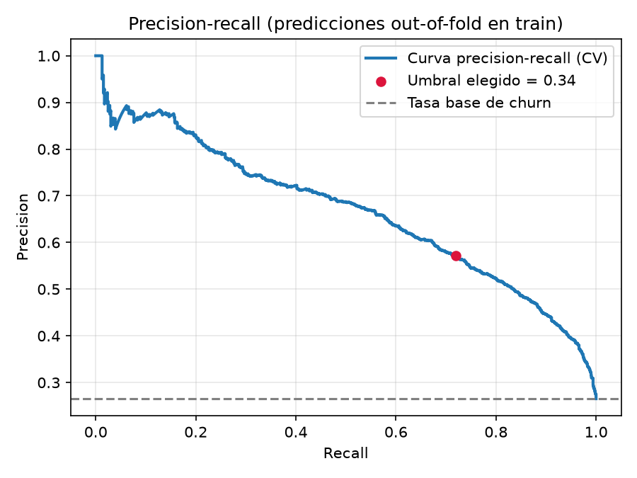

# Predicción de churn en telecomunicaciones

Modelo que estima la probabilidad de que un cliente de una empresa de telecomunicaciones abandone el servicio, expuesto como API REST (FastAPI) y empaquetado con Docker.

**Stack:** Python · pandas · scikit-learn · SQLite · FastAPI · Pydantic · Docker · pytest

## Problema

Retener a un cliente cuesta menos que conseguir uno nuevo. Dado el perfil de un cliente (contrato, antigüedad, servicios, cargos), el modelo devuelve su **probabilidad de churn** y una decisión (`churn_prediction`: `true` / `false`) basada en un umbral elegido por beneficio neto de negocio, en lugar del corte estándar de `0.50`.

## Datos

[Telco Customer Churn (Kaggle)](https://www.kaggle.com/datasets/blastchar/telco-customer-churn): 7,043 clientes, 19 variables predictoras y la columna objetivo `Churn` ($\approx 26.54\%$ de abandono).

El archivo CSV debe ubicarse en `data/WA_Fn-UseC_-Telco-Customer-Churn.csv`.

**Limpieza:** `TotalCharges` viene codificada como texto y contiene 11 valores en blanco correspondientes exclusivamente a clientes nuevos con `tenure = 0` (aún sin facturación); se convierten a numérico y se imputan con `0`.

## Método

1. **Split estratificado 80/20** con semilla fija (`random_state=42`). El 20 % de prueba ($n = 1{,}409$) permanece aislado hasta la evaluación final.
2. **Pipeline de `scikit-learn` sin *data leakage*:** recibe el DataFrame crudo y encadena ingeniería de variables $\rightarrow$ `ColumnTransformer` (`OneHotEncoder` + `StandardScaler`) $\rightarrow$ estimador, ajustándose únicamente sobre el conjunto de entrenamiento.
3. **Variables derivadas (`src/features.py`):** número total de servicios adicionales contratados, cargo mensual relativo a la antigüedad e indicador binario de cliente nuevo ($\text{tenure} \le 6$ meses).
4. **Validación cruzada estratificada (5 folds):** evalúa sobre las mismas particiones un baseline mayoritario (`DummyClassifier`), Regresión Logística, Random Forest y `HistGradientBoostingClassifier`, seleccionando el ganador por **ROC-AUC**.
5. **Elección de umbral por costos (`src/evaluate.py`):** selecciona el corte que maximiza el beneficio neto usando predicciones *out-of-fold*. Supuestos por defecto (configurables vía `python -m src.train --help`): pérdida por cliente perdido $= 500$, costo de oferta de retención $= 50$ y probabilidad de retención efectiva $= 0.30$.
6. **Implementación desde cero (`src/logreg_scratch.py`):** Regresión Logística vectorizada en NumPy entrenada mediante descenso de gradiente, validada contra `scikit-learn`.

## Resultados

### Validación cruzada (5 folds en Train; media ± desviación)

| Modelo | AUC | Precision | Recall | F1 | Accuracy |
| :--- | :---: | :---: | :---: | :---: | :---: |
| **Regresión logística** | `0.8488 ± 0.0113` | `0.6755 ± 0.0295` | `0.5304 ± 0.0394` | `0.5935 ± 0.0295` | `0.8076 ± 0.0116` |
| Random Forest | `0.8440 ± 0.0099` | `0.6727 ± 0.0332` | `0.4890 ± 0.0223` | `0.5660 ± 0.0230` | `0.8010 ± 0.0112` |
| Gradient Boosting (HistGB) | `0.8366 ± 0.0056` | `0.6369 ± 0.0244` | `0.5084 ± 0.0212` | `0.5652 ± 0.0203` | `0.7925 ± 0.0098` |
| Baseline (clase mayoritaria) | `0.5000 ± 0.0000` | `0.0000 ± 0.0000` | `0.0000 ± 0.0000` | `0.0000 ± 0.0000` | `0.7346 ± 0.0001` |

### Evaluación final en Test (Umbral = `0.34`)

El modelo seleccionado fue **Regresión logística**. Dado el desbalanceo de clases (73.46 % de retención base), `accuracy` por sí sola resulta engañosa; por ello se prioriza la capacidad de ranking (`ROC-AUC`) y el equilibrio entre captura de abandonos (`Recall`) y eficiencia de campaña (`Precision`):

| Métrica | Valor en Test |
| :--- | :---: |
| **Umbral de decisión** | `0.34` |
| **ROC-AUC** | `0.8468` |
| **Recall (Sensibilidad)** | `72.73 %` (`0.7273`) |
| **Precision** | `56.20 %` (`0.5620`) |
| **F1-Score** | `0.6340` |
| **Accuracy (vs. Baseline `73.46 %`)** | `77.71 %` (`0.7771`) |

**Matriz de confusión e impacto económico en Test ($n = 1{,}409$):**
* **Desglose:** $\text{TP} = 272$, $\text{FP} = 212$, $\text{FN} = 102$, $\text{TN} = 823$.
* **Beneficio neto del modelo:** **+USD 16,600** (frente a **−USD 14,350** al contactar a todos los clientes y **USD 0** al no contactar a ninguno).



## Estructura del proyecto

```text
├── data/                    # Dataset crudo (CSV) y base SQLite local (churn.db)
├── notebooks/01_eda.ipynb   # Análisis exploratorio con pandas
├── sql/                     # Esquema SQLite y 12 consultas analíticas
│   ├── README.md            # Diagrama de tablas y guía de las consultas
│   ├── schema.sql           # DDL normalizado (clientes, servicios, facturacion)
│   └── queries/             # 12 consultas comentadas (JOIN, HAVING, CTE, ventanas)
├── src/
│   ├── data.py              # Carga y limpieza de esquema
│   ├── features.py          # Variables derivadas
│   ├── modeling.py          # Preprocesamiento y modelos candidatos
│   ├── evaluate.py          # Métricas y optimización de umbral por costos
│   ├── train.py             # Entrenamiento CV, evaluación y serialización (.joblib)
│   ├── logreg_scratch.py    # Regresión logística vectorizada en NumPy
│   ├── schemas.py           # Contratos de entrada/salida (Pydantic v2)
│   ├── api.py               # Servicio REST con FastAPI
│   ├── build_db.py          # Crea la base SQLite desde el CSV
│   └── run_queries.py       # Ejecuta las consultas de sql/queries/
├── tests/                   # Suite de pruebas unitarias, API y SQL (pytest)
├── reports/                 # Métricas (JSON/CSV), curvas PR y resumen generado
├── Dockerfile               # Imagen de producción (python:3.11-slim)
├── .dockerignore            # Exclusión de entorno local, pruebas y artefactos
├── requirements.txt         # Dependencias mínimas de producción
└── requirements-dev.txt     # Dependencias de desarrollo, pruebas y notebooks
```

## Cómo ejecutarlo

Requiere Python 3.10 o superior.

```bash
git clone https://github.com/Johan-I4/churn-prediction.git
cd churn-prediction

python -m venv .venv
source .venv/bin/activate        # Windows PowerShell: .\.venv\Scripts\Activate.ps1
pip install -r requirements-dev.txt
```

### 1. Entrenar el modelo

```bash
python -m src.train --data data/WA_Fn-UseC_-Telco-Customer-Churn.csv
```

Genera el pipeline serializado en `models/churn_pipeline.joblib` y actualiza los reportes en `reports/`.

### 2. Levantar la API localmente

```bash
uvicorn src.api:app --reload
```

Documentación interactiva disponible en <http://127.0.0.1:8000/docs>.

```bash
curl http://127.0.0.1:8000/health

curl -X POST http://127.0.0.1:8000/predict \
  -H "Content-Type: application/json" \
  -d '{
    "gender": "Female", "SeniorCitizen": 0, "Partner": "Yes", "Dependents": "No",
    "tenure": 12, "PhoneService": "Yes", "MultipleLines": "No",
    "InternetService": "Fiber optic", "OnlineSecurity": "No", "OnlineBackup": "Yes",
    "DeviceProtection": "No", "TechSupport": "No", "StreamingTV": "Yes",
    "StreamingMovies": "No", "Contract": "Month-to-month", "PaperlessBilling": "Yes",
    "PaymentMethod": "Electronic check", "MonthlyCharges": 79.85, "TotalCharges": 958.20
  }'
```

Respuesta esperada:

```json
{"churn_probability": 0.57909, "churn_prediction": true, "threshold": 0.34}
```

Una entrada con categorías o tipos inválidos (por ejemplo `"Contract": "Three year"`) devuelve HTTP `422`.

### 3. Ejecutar con Docker

```bash
docker build -t telco-churn-api .
docker run -d -p 8000:8000 --name churn-service telco-churn-api
```

El modelo se entrena durante `docker build` para garantizar compatibilidad binaria exacta con la versión de `scikit-learn` del contenedor, por lo que el CSV debe estar presente en `data/`.

### 4. Ejecutar pruebas y modelo desde cero

```bash
# Suite de pruebas (utiliza datos sintéticos; no requiere el CSV real)
pytest -v

# Comparación de Regresión Logística en NumPy vs. scikit-learn
python -m src.logreg_scratch
```

## Base de datos SQLite y consultas SQL

El CSV se carga en SQLite y se divide en 3 tablas (`clientes`, `servicios`, `facturacion`). La carpeta [`sql/`](sql/) contiene el esquema y 12 consultas comentadas que usan `JOIN`, `HAVING`, CTE y funciones de ventana. Las pruebas comparan los resultados de SQL contra pandas.

```bash
python -m src.build_db      # crea data/churn.db
python -m src.run_queries   # ejecuta las 12 consultas
```

Hallazgos que salen de las consultas:

- **El contrato mes a mes con fibra óptica** tiene un churn de **54.61 %**, unas 2.06 veces el promedio global (26.54 %).
- **Más de la mitad de las bajas (55.5 %)** ocurre durante el primer año de antigüedad.
- **El pago con cheque electrónico** es el método con más churn en los tres tipos de contrato (53.73 % en mes a mes).
- **Los clientes mes a mes** concentran el **46.97 %** de su ingreso mensual en cuentas que se dieron de baja.

Más detalle y el diagrama de las tablas en [`sql/README.md`](sql/README.md).

## Limitaciones

- Dataset público estático; en un entorno productivo requiere monitoreo continuo de *data drift* y reentrenamiento periódico.
- El umbral óptimo (`0.34`) depende directamente de los supuestos de costos unitarios y tasa de éxito comercial.
- El modelo estima riesgo estadístico (asociación), no causalidad: no garantiza que modificar el tipo de contrato elimine el abandono por sí solo.
- Sin búsqueda exhaustiva de hiperparámetros; en este conjunto tabular, modelos basados en árboles ofrecen mejoras marginales frente a la regresión logística regularizada.

## Próximos pasos

- Búsqueda acotada de hiperparámetros (`RandomizedSearchCV`).
- Explicabilidad global y local mediante valores SHAP y análisis de errores por segmento.
- Registro de experimentos con MLflow e integración continua (CI) con GitHub Actions.

## Licencia

El código de este repositorio se distribuye bajo licencia MIT (ver [`LICENSE`](LICENSE)). El dataset pertenece a IBM y se distribuye en Kaggle bajo sus propios términos.