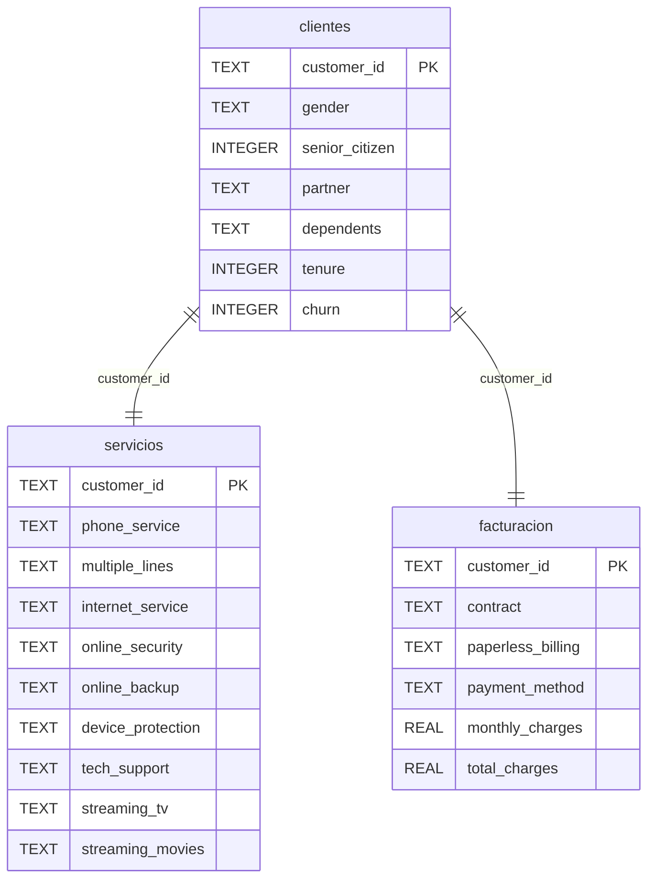

# SQL aplicado al proyecto de churn

El CSV de Telco Customer Churn se carga en **SQLite** y se divide en 3 tablas. Las 12 consultas de `queries/` responden preguntas de negocio y reproducen los números del análisis exploratorio con pandas.

## Esquema



La definición completa (llaves, restricciones `CHECK` e índices) está en [`schema.sql`](schema.sql). Los 11 valores vacíos de `TotalCharges` se guardan como `0`, igual que en el resto del proyecto.

## Cómo ejecutarlo

Desde la raíz del repositorio, con el entorno virtual activado (no necesita instalar nada más: SQLite viene con Python):

```bash
python -m src.build_db                 # crea data/churn.db (7,043 filas por tabla)
python -m src.run_queries              # ejecuta las 12 consultas
python -m src.run_queries --query 02 05  # solo algunas
```

Si tienes la herramienta `sqlite3` instalada, también puedes correr una consulta directamente:

```bash
sqlite3 data/churn.db < sql/queries/02_churn_por_contrato.sql
```

Requiere SQLite 3.25 o superior (funciones de ventana); las versiones recientes de Python ya lo incluyen.

## Consultas

Cada archivo empieza con comentarios que explican la pregunta de negocio, qué hace la consulta y cómo leer el resultado.

| # | Archivo | Pregunta | Técnicas |
|---|---|---|---|
| 01 | `01_churn_global.sql` | ¿Qué porcentaje se da de baja? | agregación |
| 02 | `02_churn_por_contrato.sql` | ¿Cambia según el contrato? | INNER JOIN, GROUP BY |
| 03 | `03_churn_por_antiguedad.sql` | ¿Abandonan más los clientes nuevos? | CASE, GROUP BY |
| 04 | `04_churn_internet_y_pago.sql` | ¿Qué combinaciones de internet y pago son más riesgosas? | JOIN de 3 tablas, WHERE, HAVING |
| 05 | `05_ingresos_en_riesgo.sql` | ¿Cuánto ingreso mensual se pierde por contrato? | SUM condicional |
| 06 | `06_cargo_mensual_por_churn.sql` | ¿Pagan más quienes se van? | JOIN, AVG, MIN, MAX |
| 07 | `07_integridad_left_join.sql` | ¿Hay clientes sin servicios o facturación? | LEFT JOIN, IS NULL |
| 08 | `08_lista_retencion_cte.sql` | ¿A qué clientes activos contactar primero? | CTE encadenadas |
| 09 | `09_ranking_pago_por_contrato.sql` | ¿Qué método de pago es más riesgoso en cada contrato? | CTE, RANK() OVER |
| 10 | `10_bajas_acumuladas_por_antiguedad.sql` | ¿Cuándo se concentran las bajas? | SUM() OVER acumulado |
| 11 | `11_segmentos_sobre_el_promedio.sql` | ¿Qué segmentos superan el promedio y cuántas veces? | HAVING con subconsulta |
| 12 | `12_cuartiles_cargo_mensual.sql` | ¿El churn sube con el cargo mensual? | NTILE |

Las consultas 01, 02, 03 y 06 reproducen exactamente los números del notebook `01_eda.ipynb`, y las pruebas (`tests/test_sql.py`) comparan los resultados de SQL contra pandas.

## Dos diferencias que conviene saber explicar

**INNER JOIN vs LEFT JOIN.** `INNER JOIN` devuelve solo las filas que tienen pareja en ambas tablas. `LEFT JOIN` conserva todas las filas de la tabla izquierda y rellena con `NULL` cuando no hay pareja. Por eso la consulta 07 usa `LEFT JOIN`: con `INNER JOIN` los clientes sin facturación desaparecerían en silencio y no se notaría el problema.

**WHERE vs HAVING.** `WHERE` filtra filas *antes* de agrupar y no puede usar funciones de agregación. `HAVING` filtra grupos *después* de agrupar y sí puede usarlas. En la consulta 04, `WHERE internet_service <> 'No'` descarta clientes y `HAVING COUNT(*) >= 100` descarta grupos pequeños.
